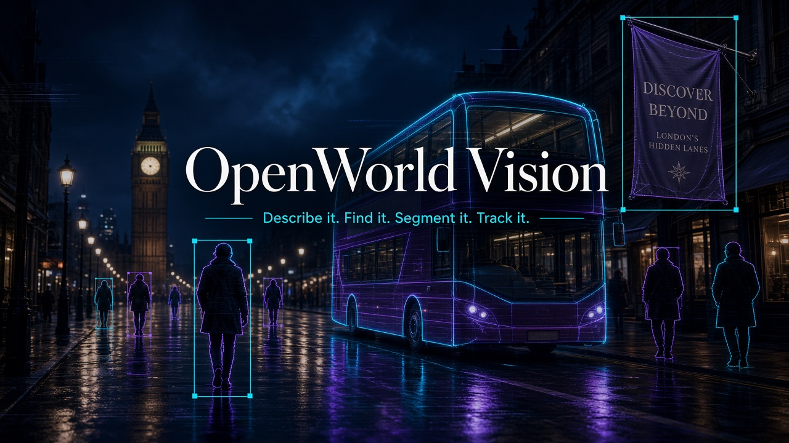
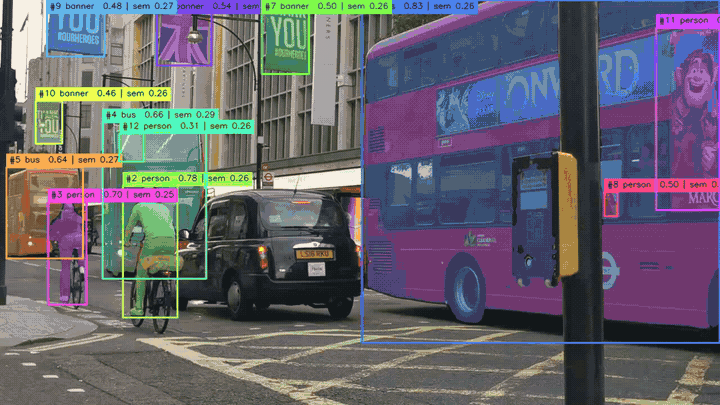
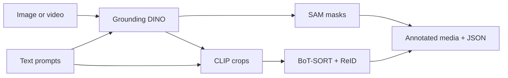

<p align="center">
  
</p>

<div align="center">

# OpenWorld Vision

**Language in. Objects, masks, and stable tracks out.**


</div>

OpenWorld Vision finds things you describe in plain language. There is no fixed list of classes. Concrete phrases such as `red double-decker bus` work better than abstract ones such as `something important`.

| | |
|---|---|
| 🎯 **Grounding DINO** | Finds boxes from your words, not from a fixed class list. |
| ✂️ **SAM** | Turns each box into a pixel mask. |
| 🔗 **CLIP** | Scores how closely a crop matches the phrase. |
| 🧭 **BoT-SORT** | Keeps one ID while the object moves and the camera shifts. |
| 🪪 **CLIP ReID** | Reuses the CLIP vector so the same object stays one track after a gap. |

---

## Demo

Street clip `samples/5330876-hd_1280_720_30fps.mp4` (1280×720, 28.4s), tracked on CUDA.

```text
person
banner
bus
```

**12 identities** held for the full clip: 7 people, 1 bus, 4 banners. 122 frames at 4.3 FPS.

<p align="center">
  
</p>

<p align="center">
  <a href="docs/demo-person-banner-bus.mp4"><strong>Play the full annotated video</strong></a>
</p>

---

## How it runs



BoT-SORT predicts motion with a Kalman filter, compensates camera shake with sparse optical flow, then matches high-confidence boxes by appearance and IoU. Weaker boxes fall back to IoU so a short miss does not split the track.

Video is sampled at the processing FPS you choose, not every source frame. The annotated file still spans the original duration.

---

## Quick start

```bash
python -m venv .venv
```

```bash
# macOS / Linux
source .venv/bin/activate
```

```powershell
# Windows
.\.venv\Scripts\Activate.ps1
```

```bash
python -m pip install --upgrade pip
pip install .
```

On Windows, if `pip` pulls a CPU-only PyTorch build, install a CUDA wheel first, then run `pip install .` again. Copy `.env.example` to `.env` and set `OPENWORLD_DEVICE=cuda` when you want to force the GPU. Otherwise the app picks CUDA, then Apple MPS, then CPU.

```bash
uvicorn app.main:app --host 0.0.0.0 --port 8000
```

Open [http://localhost:8000](http://localhost:8000). API reference: [http://localhost:8000/docs](http://localhost:8000/docs).

Docker: `docker compose up --build` (the compose file requests `gpus: all`; drop that line for CPU). The first request downloads the Hugging Face weights.

---

## Models and settings

| Stage | Default | Role |
|---|---|---|
| Detection | `IDEA-Research/grounding-dino-tiny` | text-conditioned boxes |
| Segmentation | `facebook/sam-vit-base` | masks from those boxes |
| Embeddings | `openai/clip-vit-base-patch32` | similarity and re-identification |

```env
OPENWORLD_DEVICE=auto
OPENWORLD_DETECTOR_MODEL=IDEA-Research/grounding-dino-tiny
OPENWORLD_SAM_MODEL=facebook/sam-vit-base
OPENWORLD_CLIP_MODEL=openai/clip-vit-base-patch32
OPENWORLD_MAX_UPLOAD_MB=250
OPENWORLD_MAX_VIDEO_SECONDS=30
OPENWORLD_DEFAULT_VIDEO_PROCESS_FPS=4
OPENWORLD_MAX_OBJECTS=20
```

| Control | Typical range |
|---|---|
| Detection threshold | 0.25 – 0.45 |
| Text threshold | 0.20 – 0.35 |
| Max objects | 5 – 20 |
| Processing FPS | 2 – 6 |

One target per line, or separate phrases with semicolons. Commas stay inside a phrase, so `small drone, flying low` is a single prompt.

---

## API

```bash
curl http://localhost:8000/api/health
```

```bash
curl -X POST http://localhost:8000/api/image \
  -F "file=@sample.jpg" \
  -F $'prompt=person wearing a red helmet\nsmall drone' \
  -F "box_threshold=0.35" \
  -F "text_threshold=0.25" \
  -F "max_objects=12"
```

```bash
curl -X POST http://localhost:8000/api/video \
  -F "file=@clip.mp4" \
  -F $'prompt=person\nbanner\nbus' \
  -F "box_threshold=0.30" \
  -F "text_threshold=0.25" \
  -F "max_objects=12" \
  -F "process_fps=4"
```

`POST /api/stop` cancels the job in progress. Annotated files land in `results/` as `<original>_<YYYY-MM-DD>_<HH-MM-SS>.png` or `.mp4`. **Download Result** shows that file in the results folder. It does not open a browser download.

---

## Tests

```bash
pip install ".[dev]"
pytest
ruff check app tests
```

Tests cover prompt parsing, association math, and mask polygons. They do not download model weights.

---

## Limits

- A new phrase is not guaranteed to hit.
- Small or occluded objects are easy to miss.
- CLIP scores are relative, not probabilities.
- Video is sampled, not real-time.
- The API has no auth and does not delete old files in `results/`.
- Model cards have their own licenses. This repo is MIT.
